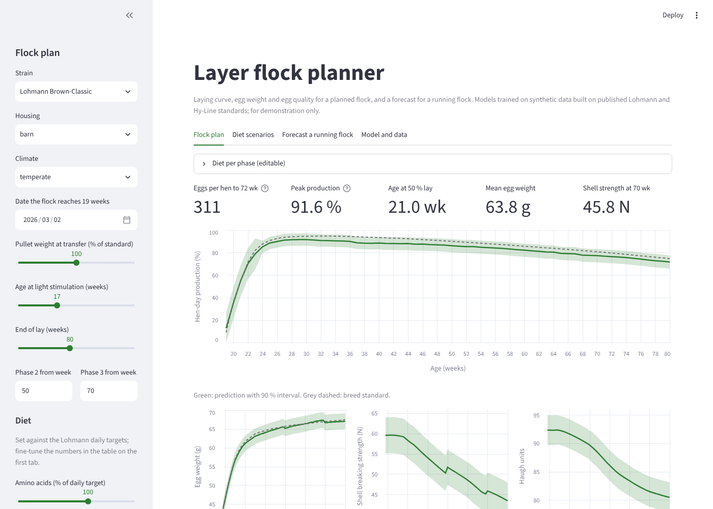
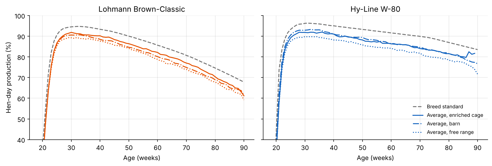
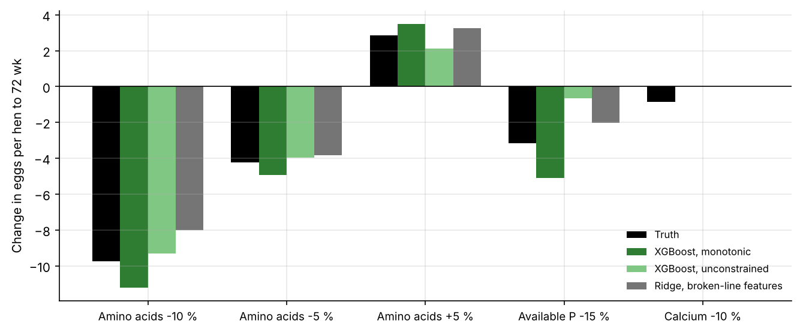
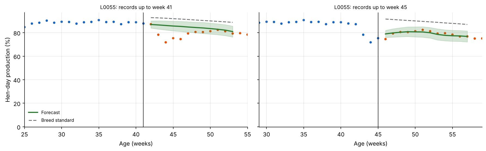
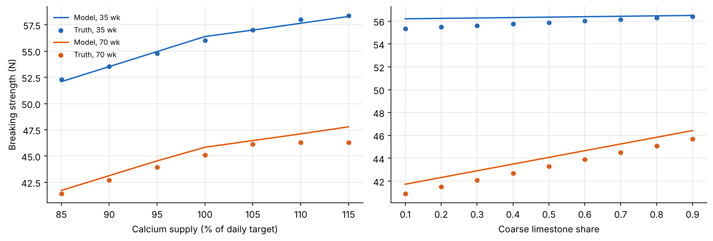

# Layer Flock Performance: Laying Curve, Egg Quality and In-Cycle Forecasting

Machine learning models that plan the laying curve, egg weight and egg quality of a layer flock before it starts laying, and forecast hen-day production of a running flock 1 to 12 weeks ahead. The models are served through a REST API in a Docker container and through a Streamlit app.

**Author:** Mahdi Dadgar, PhD in Animal Nutrition and Feed Science


## The problem

A layer flock lays for 60 to 70 weeks, and its laying curve decides most of its income. Two questions come up on every farm and at every feed company:

1. **Planning.** Before the flock starts laying, what curve can I expect from its strain, house, pullet weight, lighting programme and planned diets? What happens to egg number, egg weight and shell quality if I change the diet?
2. **Forecasting.** The flock is in lay and I have its weekly records. What will it produce over the next three months?

Breed standards answer neither question well. Field flocks rarely reach the standard, and the gap depends on the farm. This project builds both models, checks them on farms they never saw, and deploys them.



## About the data

Public data on layer nutrition and flock performance are scarce, so I built a **synthetic** data set on published standards:

* weekly hen-day production, egg weight and feed intake from the **Lohmann Brown-Classic** management guide and the **Hy-Line W-80** performance standards;
* daily nutrient targets per phase from the **Lohmann Brown-Classic** nutrition recommendations;
* Haugh units by age from the **Hy-Line** guides, and shell breaking strength by age from **Benavides-Reyes et al. (2021)**.

On top of the standards come 52 farms with their own housing, climate and nutrition policy, 622 flocks placed between 2018 and 2026, formulated and delivered diets, house temperature with heat waves, disease episodes that are not recorded, measurement noise and missing records. In total there are 38,448 weekly records and 8,259 egg quality samples (30 eggs every four weeks).

The effects of diet, housing, heat and disease are my assumptions, chosen to be plausible and in the direction reported in the literature. The data show a working method; the numbers are not findings about real flocks. Every source and assumption is listed in [docs/methodology.md](docs/methodology.md).



## Planning a flock

The planning models use only what is known before lay. Diets enter as **supply relative to requirement**: expected daily intake of each nutrient divided by the daily target for that age, with broken-line terms for the shortfall below requirement.

All scores below are on **11 farms held out from training** (130 flocks).

| Model, weekly hen-day production | RMSE (points) | R² | Eggs per hen to 72 wk, mean error |
|---|---|---|---|
| Breed standard | 9.01 | 0.63 | 24.1 (all overestimates) |
| Average of training flocks by strain and age | 6.04 | 0.83 | 11.3 |
| Ridge regression, broken-line features | 5.66 | 0.85 | 8.8 |
| Yang laying curve, parameters predicted from the flock plan | 4.90 | 0.89 | 8.7 |
| **XGBoost with monotonic constraints (chosen)** | **4.60** | **0.90** | 9.3 |

The breed standard overestimates field flocks by 24 eggs per hen to 72 weeks. The models come within about 9 eggs out of roughly 320. What is left is mostly the farm itself: every held-out farm has its own level that no plan can predict. That is why the in-cycle forecast matters.

I chose the monotonic XGBoost model because it is the most accurate week by week and every diet effect has the right direction. Diet features may interact with each other but not with age, house or season, which keeps the diet response stable. The Yang curve (Yang, Wu and McMillan, 1989) is almost as good and easier to explain, so the app uses it to summarise each predicted curve: scale, persistency, uniformity of onset and age at maturity.

## Checking the diet response

A model can predict flocks well and still get the effect of a diet change wrong, because diets in field data move together. With synthetic data the true response is known, so I tested it: for 60 held-out flocks I changed the diet in all phases and compared the predicted change with the true change.



The chosen model gets every direction right but overstates the losses somewhat: 11 eggs for a 10 % amino acid cut against a true 10, and 5 eggs for a 15 % phosphorus cut against a true 3. An earlier version also predicted a loss of 3 eggs from a 10 % calcium cut against a true loss below one. Calcium and amino acid supply move together in the data because both depend on the feed intake the nutritionist assumed. In the normal range calcium acts on the shell, so I left it out of the laying-rate model and kept it in the shell model.

## Forecasting a running flock

At any week from 24 to 80, the forecast model takes the records so far and predicts hen-day production 1 to 12 weeks ahead. It predicts the deviation from the breed standard from the recent deviation and its trend, feed intake, mortality, egg weight and house temperature, together with the planned diet and the normal temperature for the coming weeks.

Mean absolute error (hen-day percentage points) on the held-out farms:

| Method | 1 week | 4 weeks | 8 weeks | 12 weeks | During a disease episode |
|---|---|---|---|---|---|
| Breed standard | 6.40 | 6.44 | 6.55 | 6.67 | 9.98 |
| Planning model (no records) | 3.07 | 3.06 | 3.08 | 3.09 | 4.59 |
| Last week carried forward | 1.50 | 2.65 | 3.69 | 4.61 | 3.22 |
| Standard × recent ratio to standard | 2.01 | 2.59 | 3.12 | 3.46 | 3.44 |
| Yang curve refitted to the weeks so far (from 32 weeks) | 2.32 | 2.89 | 3.69 | 4.54 | 4.53 |
| **XGBoost forecast** | **1.52** | **1.96** | **2.18** | **2.30** | **2.43** |

One week ahead, carrying last week forward is as good as the model. From two weeks on the model beats every simple rule, and the gap is largest during disease episodes, because it has learned how flocks usually recover. The 90 % intervals covered 89.5 % of outcomes on the held-out farms.



## Egg weight and egg quality

| Target | Breed standard RMSE | Chosen model | RMSE | R² | 90 % interval coverage |
|---|---|---|---|---|---|
| Egg weight (g) | 1.85 | Ridge, broken-line features | 1.19 | 0.95 | 92.5 % |
| Shell breaking strength (N) | 3.23 | Ridge, broken-line features | 2.59 | 0.85 | 91.3 % |
| Haugh units | 2.08 | Ridge, broken-line features | 2.02 | 0.72 | 79.9 % |

For all three targets ridge regression did as well as or better than XGBoost, so I used the simpler model. The shell model follows the broken-line response to calcium and learned that coarse limestone matters more in older hens.

Haugh units are an honest negative result. In this data they depend mostly on age, heat and unrecorded disease, and no model does much better than the breed curve. The interval coverage is also low, because the held-out farms happened to differ more in Haugh units than the training farms. On real farms, egg storage time and temperature would be the first things to record.



## Deployment

The same prediction code (`src/predict.py`) serves two front ends, so they always agree.

**REST API** (FastAPI, in a Docker container)

| Endpoint | What it does |
|---|---|
| `GET /health` | Status and model version |
| `GET /model-info` | Validation scores and intended use from the model card |
| `POST /predict/flock` | Flock plan in, weekly predictions with 90 % intervals, a summary and input warnings out |
| `POST /forecast` | Flock plan and weekly records in, 1-12 week forecast with intervals out |

Inputs are validated (ranges, phase order, at least four weeks of records), and the response warns when a diet is outside the range the models were trained on. Interactive documentation is at `/docs`.

```bash
docker build -t layer-flock-api .
docker run -p 8000:8000 layer-flock-api
curl -X POST localhost:8000/predict/flock -H "Content-Type: application/json" -d @docs/api_examples/plan_request.json
```

**Streamlit app** with four tabs: plan a flock, compare diet scenarios, forecast a running flock (example flocks from held-out farms or your own CSV), and the model card.

**Continuous integration.** On every push GitHub Actions runs the test suite (models, API, app, data and feature checks), then builds the Docker image, starts the container and calls both endpoints.

How to host the API and app, and how to retrain the models when new data arrive, is described in [docs/deployment.md](docs/deployment.md).

## Repository layout

```
app.py                          Streamlit app
api/
  main.py                       FastAPI service
  schemas.py                    request and response validation
Dockerfile                      API image
data/
  standards/                    published breed standards, nutrient targets, egg quality by age
  raw/                          synthetic flocks, weekly records, egg quality samples
  truth/                        hidden farm effects, disease episodes, true values (validation only)
models/                         trained models and model_card.json
src/
  standards.py                  breed standards and requirements on a weekly grid
  responses.py                  the assumed response to diet, heat and disease
  generate_data.py              synthetic data generator
  features.py                   planning features, supply relative to requirement
  curves.py                     Yang laying curve
  modeling.py                   models, grouped validation, intervals
  compare_models.py             accuracy and diet response check for all candidates
  forecast.py                   in-cycle forecast
  train.py                      trains and saves the deployed models
  predict.py                    prediction service used by the API and the app
  truth.py                      true response of the synthetic data (validation only)
notebooks/
  01_standards_and_data.ipynb
  02_laying_curve_and_forecast.ipynb
  03_egg_weight_and_quality.ipynb
tests/                          pytest suite
docs/                           methodology, deployment guide, API examples
.github/workflows/tests.yml     tests and Docker build on every push
```

## How to run

Python 3.12 or 3.13.

```bash
python -m venv .venv
source .venv/bin/activate          # Windows: .venv\Scripts\activate
pip install -r requirements-dev.txt

streamlit run app.py               # the app
uvicorn api.main:app --reload      # the API, docs at http://127.0.0.1:8000/docs
pytest -q                          # tests
```

To rebuild everything from scratch:

```bash
python -m src.generate_data        # synthetic data (about 10 seconds)
python -m src.compare_models       # model comparison and diet response check (about 2 minutes)
python -m src.train                # validated models, intervals and model card (about 3 minutes)
```

## Limits

* All effects of diet, housing, heat and disease come from the synthetic generator, so the models can only rediscover them.
* Both strains share the Lohmann Brown-Classic daily nutrient targets, and the brown strain uses the Hy-Line Brown Haugh unit curve because Lohmann does not publish one.
* Shell strength by age comes from one study of white hens and is assumed for both strains.
* Feed intake, body weight, mortality and economics are inputs or side outputs, not modelled targets.
* Disease is not recorded, so the planning models cannot foresee it; the forecast reacts once it shows in the records.

## Sources

* Lohmann Breeders, *Lohmann Brown-Classic Management Guide: performance data and recommended nutrient levels* (cage housing e-guide, 2021).
* Hy-Line International, *Hy-Line W-80 Commercial Layers Performance Standards* (2026) and *Hy-Line Brown Commercial Layers Performance Standards* (2025).
* Benavides-Reyes, C. et al. (2021). Research note: Changes in eggshell quality and microstructure related to hen age during a production cycle. *Poultry Science* 100: 101287.
* Yang, N., Wu, C. and McMillan, I. (1989). New mathematical model of poultry egg production. *Poultry Science* 68: 476-481.
* Coertze, G. et al. (2025). Influence of dietary energy and lysine concentration on layer hen performance and egg quality during peak production. *Poultry* 4(2): 26.

## License

MIT. See [LICENSE](LICENSE).
